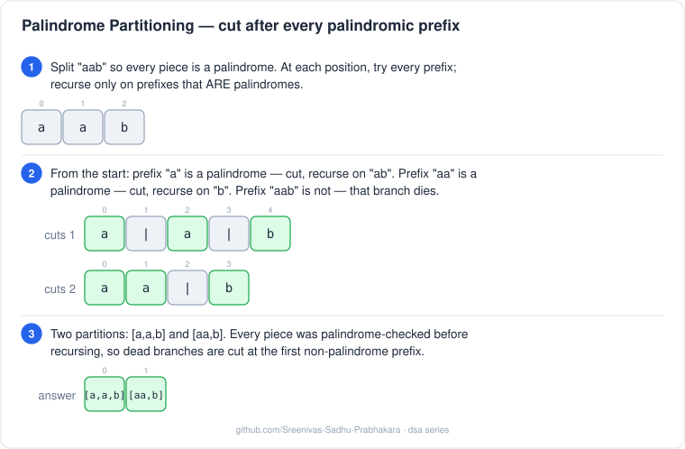

# Palindrome Partitioning (All Ways)

> Striver SDE Sheet 053 · Day 9 Recursion — at each cut point, extend only along palindromic prefixes; non-palindromes kill whole subtrees. Go, stdlib only, tested.

## Problem

Return every way to split a string into pieces such that each piece is a palindrome. `"aab"` has two: `[a, a, b]` and `[aa, b]`.

## Approach

Backtracking over cut positions. From the current start, try each prefix; only when it is a palindrome does the recursion continue past it — the palindrome test is the pruning, discarding entire families of partitions on the first bad prefix. Reaching the end of the string means the pieces on the path form one valid partition. (The sheet's Day 26 twin asks only for the *minimum number of cuts* — that version drops the enumeration and becomes DP; enumerating all partitions is inherently exponential because the answer can be.)

**Complexity:** O(2ⁿ · n) worst case (all-same-letter strings realize it), O(n) depth.

## Visual walkthrough

Read the picture top to bottom — each numbered frame is one moment of the algorithm
running on this repo's test example.

## Run

    go test ./...   # verify
    go run .        # demo

---

One of 191 repos solving Striver's SDE Sheet in Go — stdlib only, one problem per repo, every solution tested. Browse the set: [`dsa-*` repos](https://github.com/Sreenivas-Sadhu-Prabhakara?tab=repositories&q=dsa-&type=source).
